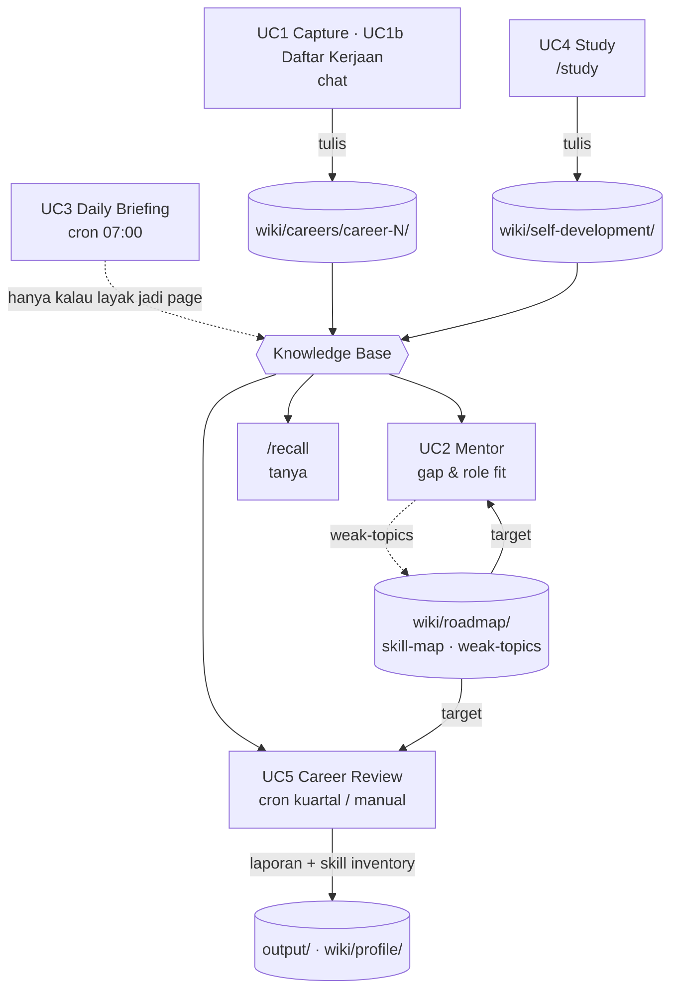
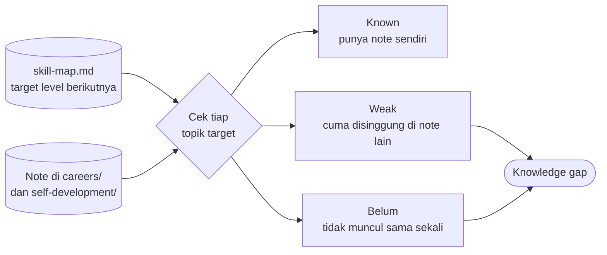

# 02 · Use Cases

Legenda status pada acceptance criteria (AC):

- ✅ Sudah tertulis di prosedur runtime (`hermes-home/`)
- ⚠ Gap yang sudah diketahui, sudah ada kode backlog atau pertanyaan terbuka
- ⏳ Belum aktif di VPS
- ℹ Catatan, bukan kriteria uji

## Ringkasan

| ID | Use case | Trigger | Output utama | Prosedur runtime |
|---|---|---|---|---|
| UC1 | Capture Experience | User bercerita pengalaman kerja | Note incident, knowledge, atau lesson di folder career aktif | [`capture-experience.md`](../hermes-home/igrow/project-skills/capture-experience.md) |
| UC1b | Daftar Kerjaan Baru | "pindah kerja" / "daftar kerjaan baru" | Folder `career-N` baru, career lama ditutup | `capture-experience.md` § Daftar Kerjaan Baru |
| UC2 | Mentor | Pertanyaan roadmap, kelemahan, atau role fit | Analisis gap + rekomendasi personal | [`mentor.md`](../hermes-home/igrow/project-skills/mentor.md) |
| UC3 | Daily Briefing | Cron setiap hari 07:00 | Ringkasan maks. 5 berita di Telegram | [`daily-briefing.md`](../hermes-home/igrow/project-skills/daily-briefing.md) |
| UC4 | Study | `/study` atau cerita selesai belajar | Learning note di `self-development/` | [`study.md`](../hermes-home/igrow/project-skills/study.md) |
| UC5 | Career Review | Cron kuartalan atau permintaan manual | Laporan kuartal + skill inventory | [`career-review.md`](../hermes-home/igrow/project-skills/career-review.md) |
| — | `/recall` | `/recall <pertanyaan>` | Jawaban dari wiki + path page sumbernya, atau "belum ada catatan" | [`AGENTS.md`](../hermes-home/AGENTS.md) § Perintah |
| M1 | Lint Mingguan | Cron Minggu 08:00 | Laporan kesehatan wiki | [`maintenance/lint.md`](../hermes-home/igrow/project-skills/maintenance/lint.md) |
| M2 | Backup | Cron Senin, Rabu, Sabtu 05:00 | Commit + push `igrow/` ke GitHub privat | [`maintenance/backup.md`](../hermes-home/igrow/project-skills/maintenance/backup.md) |

## Bagaimana UC Saling Memberi Makan



Daily Briefing (UC3) berdiri sendiri: tidak membaca knowledge base, dan hanya menulis ke wiki kalau ada berita yang layak dijadikan page. Skill map di-generate oleh UC2 atau UC5 kalau belum ada, lalu beku per level.

Contoh: satu cerita incident dicatat UC1. Incident itu kemudian dikenali UC2 sebagai pengalaman yang sudah dimiliki, dan dihitung UC5 di review kuartal.

---

## UC1 · Capture Experience

**User story:** Sebagai IT worker, saya ingin menceritakan incident atau pengalaman kerja lewat Telegram dengan bahasa bebas, supaya ceritanya otomatis tersimpan sebagai note terstruktur di arsip career saya.

**Target jangka panjang:** bisa menjawab *"Apa saja yang sebenarnya sudah saya kerjakan selama 3 tahun?"*

**Trigger:** user bercerita soal pekerjaan (bukan `/study`).

**Alur utama:**
1. Hermes menentukan career aktif dan menyebutkannya di balasan.
2. Hermes mengklasifikasi cerita menjadi incident, knowledge, atau lesson, dan menuliskan satu baris alasannya.
3. Data sensitif diredaksi.
4. Note disusun sesuai `SCHEMA.md`, termasuk pencocokan tag ke taxonomy.
5. Self-check, lalu file ditulis.
6. Index dan log diperbarui.

**Lokasi output:**

| Jenis cerita | Lokasi |
|---|---|
| Incident (ada gejala, investigasi, hasil) | `wiki/careers/<aktif>/knowledge/incidents/YYYY-MM-DD-<slug>.md` (tanggal kejadian, D-29) |
| Knowledge (SOP, cara kerja, setup, tanpa kejadian) | `wiki/careers/<aktif>/knowledge/<slug>.md` (flat, tanpa subfolder per topik) |
| Lesson learned | `wiki/careers/<aktif>/lessons-learned/` |
| Skill yang terpakai | `wiki/careers/<aktif>/skills.md` |
| Screenshot (sudah diredaksi) | `raw/assets/YYYYMMDD-deskripsi.png` |

**Contoh:**

Input di Telegram:

> "Hari ini ada alert CPU tinggi. Saya cek monitoring, ternyata proses X yang menyebabkan spike. Setelah beberapa menit CPU normal lagi. Saya belajar bahwa pattern ini kemungkinan workload spike."

Inti note yang dihasilkan (format lengkap mengikuti SCHEMA dan contoh di `capture-experience.md`):

```text
Incident: High CPU
Symptom:        CPU utilization > 90%
Investigation:  cek monitoring → proses X penyebab spike
Finding:        workload spike, bukan masalah resource permanen
Action:         pantau, tanpa intervensi
Result:         CPU normal kembali setelah beberapa menit
Lesson Learned: pola ini kemungkinan workload spike; cek tren sebelum eskalasi
```

**Acceptance criteria:**
- ✅ Cerita incident menghasilkan file baru `incidents/YYYY-MM-DD-<slug>.md` (tanggal kejadian) di career aktif, dengan body alur Symptom / Investigation / Finding / Action / Result / Lesson Learned.
- ✅ Frontmatter lengkap sesuai SCHEMA, tag hanya dari taxonomy, `sources` berisi `[]` atau path `igrow/raw/...`.
- ✅ Bagian See Also berisi minimal 2 dual-link. Note lama yang ditaut mendapat link balik di See Also-nya, tanpa mengubah `updated:` note lama itu.
- ✅ Nama file note unik di seluruh `wiki/` (aturan slug di SCHEMA § Link).
- ✅ Nama client, IP, hostname, dan credential tidak muncul di file mana pun, termasuk title dan nama file. Self-check sebelum tulis ikut memeriksanya.
- ✅ Balasan berisi path file, career aktif + alasan pemilihan type/folder, rangkuman 3–5 poin isi note (incident: kejadian / penyebab / tindakan / pelajaran), tag, link placeholder baru, note lama yang dapat link balik, dan jenis data yang diredaksi. Isi note lengkap hanya kalau diminta.
- ✅ Waktu relatif ("kemarin", "minggu lalu") ditulis sebagai tanggal absolut. Tanggal kejadian incident ada di kalimat pertama Ringkasan; kalau tidak pasti, ditulis "sekitar <tanggal>".
- ✅ Setelah menulis: `wiki/_index.md` (+ `raw/_index.md` kalau ada screenshot), master `_index.md` (Total pages + Last updated), dan `log.md` (op `ingest`/`update`) ikut diperbarui.
- ✅ Kalau cerita baru bertentangan dengan note lama: Hermes bertanya sekali, field `contradictions` diisi, dan note lama tidak dihapus.
- ✅ Kalau tidak ada tag yang cocok (< 60%): Hermes bertanya sekali dengan 3 opsi terdekat.
- ✅ Cerita lanjutan tentang incident yang sama memperbarui file lama (`updated:` diganti, `created:` tetap), bukan membuat duplikat.
- ✅ Kalau tidak ada career aktif: Hermes tidak menulis file dan menawarkan alur Daftar Kerjaan Baru.

## UC1b · Daftar Kerjaan Baru

**User story:** Sebagai IT worker yang pindah kerja, saya ingin mendaftarkan pekerjaan baru lewat chat, supaya catatan berikutnya otomatis masuk ke career yang benar dan career lama menjadi arsip final.

**Trigger:** "daftar kerjaan baru", "pindah kerjaan", atau cerita soal tempat kerja baru.

**Acceptance criteria:**
- ✅ Hermes bertanya satu ronde: company, role beserta level (mis. Infra Engineer L1), vendor/client, lokasi, tanggal mulai, dan jobdesc singkat.
- ✅ `about.md` career lama diberi tanggal selesai (`Period: <start> s/d <hari ini>`).
- ✅ Folder baru `wiki/careers/career-N-{company}-{role}/` dibuat, dengan N = nomor berikutnya.
- ✅ `about.md` berformat plain `Key: value` tanpa frontmatter, dan `skills.md` dibuat kosong.
- ✅ Index dan log diperbarui (op `update`).
- ℹ Career pertama boleh dibuat manual oleh user (`about.md` adalah file milik user). Agent hanya boleh menulis `about.md` di alur ini.

**Contoh `about.md`** (format mengikuti `capture-experience.md`; tanpa tanggal selesai berarti career aktif):

```text
Company: PT ABC
Role: Infra Engineer L1
Vendor/Client: client A (anonim)
Lokasi: Kuala Lumpur
Period: 2025-01-01 s/d
Jobdesc: Monitoring & incident response, troubleshooting Linux/Windows Server, escalation handling.
```

Dengan pemisahan per career, setiap note otomatis punya konteks "dari pekerjaan mana". Saat resign, folder `career-1-...` menjadi arsip final dan catatan baru masuk ke `career-2-...`.

## UC2 · Mentor

**User story:** Sebagai IT worker yang ingin naik level, saya ingin tahu topik apa yang harus dipelajari dan role apa yang cocok berdasarkan catatan saya sendiri, supaya waktu belajar dipakai untuk gap yang nyata, bukan tutorial acak.

**Trigger:** pertanyaan seperti "harus belajar apa", "kelemahan saya apa", atau "role apa yang cocok".

**Alur utama:**
1. Pastikan `wiki/roadmap/skill-map.md` ada. Kalau belum, generate dulu dari `careers/` dan `self-development/`. Skill map beku per level: tidak di-generate ulang karena ada data baru.
2. Beri status tiap topik target: Known (punya note), Weak (cuma disinggung di note lain), atau Belum (tidak muncul). Gap = Weak + Belum. Definisinya ada di `SCHEMA.md` § skill-map.md format dan dipakai juga oleh UC5.
3. Beri jawaban sesuai jenis pertanyaan:
   - **Roadmap:** tabel Known / Weak / Belum, rekomendasi personal, update `weak-topics.md`.
   - **Role fit:** tabel kecocokan role dalam bentuk X/Y topik, 2 role paling cocok dan 2 paling jauh, beserta gap masing-masing.

**Contoh:**

```text
Saya: "Saya mau belajar networking lebih dalam."

Known:       ✓ Ping   ✓ DNS basic   ✓ TCP/IP basic
Weak:        ⚠ Routing   ⚠ Packet analysis   ⚠ TCP behavior
Experience:  ✓ Connection timeout   ✓ Packet loss

Hermes: "Karena kamu sudah pernah mengalami timeout dan packet loss,
         kita mulai dari TCP connection lifecycle sebelum masuk ke routing."
```

**Acceptance criteria:**
- ✅ Kalau note di `careers/` kurang dari 3: jawab "Data karier belum cukup untuk gap analysis (minimal 3 incident/knowledge)" dan tidak mengarang roadmap generik.
- ✅ Kalau skill map belum ada: generate dulu, jangan menolak menjawab.
- ✅ Setiap baris skill menyebut bukti konkret (nama note atau incident beserta tanggal, atau "0 note").
- ✅ Persentase role fit menampilkan pembilang dan penyebut ("6/8 topik", bukan hanya "75%").
- ✅ Rekomendasi menyebut note atau incident yang menjadi dasarnya.
- ✅ Kalau ada file yang ditulis (skill map, weak topics): index dan log diperbarui (op `update`).

### Cara Knowledge Gap Ditemukan

Gap bukan tebakan insting Hermes. Gap adalah hasil perbandingan dua sumber data:

| Sumber | Lokasi | Menjawab |
|---|---|---|
| Knowledge yang sudah terdokumentasi | `wiki/careers/*/knowledge/` (termasuk `incidents/`), `wiki/careers/*/lessons-learned/`, `wiki/self-development/` | "Apa yang sudah saya punya?" |
| Target skill | `wiki/roadmap/skill-map.md` (level berikutnya) | "Apa yang *seharusnya* saya kuasai?" |



**Contoh konkret:** `career-1/knowledge/` penuh catatan Linux dan monitoring, tapi tidak ada satu pun note tentang automation, baik di `careers/` maupun `self-development/`. Output yang diharapkan:

> "Automation/IaC belum pernah didokumentasikan sama sekali, kemungkinan gap. Networking dasar sudah kuat, tapi routing baru muncul sekali di satu incident."

**Prasyarat:** fitur ini butuh bahan. Urutannya: rutin capture (UC1) dan study (UC4) dulu, baru minta gap analysis (UC2/UC5). Skill map dibuat otomatis, jadi kekosongan data karier adalah satu-satunya alasan jawaban menjadi tipis.

**Konsistensi nama topik:** kalau topik yang sama ditulis dengan nama berbeda setiap kali, hasil gap analysis terpecah. Mitigasinya: tag dari taxonomy (`igrow/taxonomy.md`) dan fuzzy-match nama topik. Aturan pencocokannya ada di SCHEMA: topik dihitung punya note kalau ada note yang judul atau Ringkasan-nya membahas topik itu. Yang cuma disinggung di note lain dihitung Weak.

## UC3 · Daily Briefing

**User story:** Sebagai IT worker, saya ingin menerima ringkasan berita teknologi yang relevan setiap pagi, supaya tidak ketinggalan hal penting (terutama CVE) tanpa harus membaca banyak sumber.

**Trigger:** cron setiap hari pukul 07:00 (`0 7 * * *`, zona waktu Asia/Kuala_Lumpur).

**Topik:** linux, windows-server, kubernetes, docker, vmware, cloud, networking, monitoring, devops, sre, security, cve.

**Contoh output (format yang diinginkan):**

```text
DAILY INFRA BRIEFING
10 August 2026

1. Linux
   [News] ...
   Why it matters: ...

2. Kubernetes
   [Release/update] ...
   Why it matters: ...

3. Security
   [CVE] ...
   Affected technology: ...
   Severity: ...
   Why you should care: ...

4. Career
   [Technology trend] ...
   Relevant skill: ...
```

Prinsip: lebih baik **5 informasi penting + alasan kenapa perlu peduli** daripada banyak berita.

**Acceptance criteria:**
- ⏳ Briefing tiba di Telegram sekitar pukul 07:00 setiap hari (cron belum dibuat di VPS).
- ✅ Maksimal 5 item. Setiap item punya topik, isi berita, dan alasan kenapa penting (item Career: skill yang relevan).
- ✅ Sebelum format akhir, Hermes menulis satu baris alasan pemilihan per item.
- ✅ Secara default tidak ada yang ditulis ke `wiki/`. Hanya berita yang layak dijadikan page yang di-ingest (dengan aturan index dan log).
- ⚠ Sumber berita berasal dari web research bebas, sehingga kualitasnya bergantung pada tool search Hermes (lihat [OQ-07](06-risks-decisions.md#3-pertanyaan-terbuka)).
- ✅ Item CVE wajib menyertakan Affected technology dan Severity. Boleh ada 1 item Career (tren teknologi + skill relevan).

## UC4 · Study (`/study`)

**User story:** Sebagai IT worker yang belajar mandiri (bootcamp, artikel, dokumentasi, proyek pribadi), saya ingin hasil belajar saya dirapikan menjadi note terstruktur beserta sumbernya, supaya bertahun-tahun kemudian saya masih tahu apa yang dipelajari dan dari mana.

**Trigger:** `/study <cerita>`, atau cerita selesai belajar sesuatu.

**Variasi perintah:**
- `/study baru selesai materi X di KodeKloud: ...` → note terstruktur.
- `/study bandingkan A dengan B` → page komparasi di folder sumber yang relevan.
- `/study baru belajar networking Kubernetes, ringkasin buat level saya` → ringkasan disesuaikan dengan level user (dari `Role` di `about.md` career aktif).

**Contoh:**

```text
Saya: "/study baru selesai materi systemd di KodeKloud: service unit, target, journalctl, dst."

raw/articles/2026-08-22-kodekloud-systemd.md        (sumber, kalau ada link atau materi)
wiki/self-development/Bootcamp/kodekloud-systemd/
├── systemd-service-unit.md
├── systemd-target.md
└── journalctl.md                                    (setiap note: tags [linux], template lengkap SCHEMA)
```

Satu folder per sumber belajar, berisi satu atau lebih note per sub-topik. Setiap note memakai template lengkap SCHEMA. Note tidak dipecah per jenis isi seperti `concepts.md` / `commands.md` / `references.md`, karena Contoh dan Referensi sudah menjadi section di setiap note ([D-20](06-risks-decisions.md#2-decision-log)).

**Acceptance criteria:**
- ✅ Sumber mentah (link, PDF, artikel) masuk ke `raw/inbox/`, diproses, lalu dipindah ke `raw/articles/` dengan nama `YYYY-MM-DD-nama.md` setelah note tertulis, dan tercatat di `raw/_index.md`. Inbox kosong berarti semua sudah diproses.
- ✅ Note ditulis di `wiki/self-development/{Project|Bootcamp|Dokumentasi}/<nama>/` dengan `type: learning`.
- ✅ `sources` merujuk ke `igrow/raw/articles/...`, bukan ke inbox.
- ✅ Body memakai template SCHEMA: Ringkasan / Detail / Contoh / Referensi / See Also. Note lama yang ditaut mendapat link balik (SCHEMA § Link), dan nama file note unik di seluruh `wiki/`.
- ✅ Balasan berisi path note dan path sumber di `raw/articles/`, tag + alasan, dan rangkuman per note (inti + 2–4 poin yang dipelajari). Isi note lengkap hanya kalau diminta.
- ✅ Data terlarang (`AGENTS.md` § DILARANG KERAS) diredaksi sebelum sumber masuk `raw/inbox/`, dan note diperiksa lagi di self-check (termasuk title dan nama file).
- ✅ Index dan log diperbarui (op `ingest`).

## UC5 · Career Review (Kuartalan)

**User story:** Sebagai IT worker, saya ingin review karier setiap kuartal yang dihitung dari catatan saya sendiri, supaya saya punya jawaban objektif untuk "saya berkembang atau tidak?" dan tahu langkah berikutnya.

**Trigger:** cron pukul 09:00 setiap tanggal 1 Januari, April, Juli, dan Oktober (`0 9 1 1,4,7,10 *`), atau permintaan manual.

**Isi laporan:**
- **Learned:** skill baru yang terdokumentasi kuartal ini.
- **Experienced:** incident dan pengalaman kerja.
- **Improved:** topik yang note-nya makin dalam.
- **Weak:** topik target di skill map yang berstatus Weak atau Belum.
- **Pola:** tag yang paling sering muncul, topik yang stagnan, dan kesalahan yang berulang.
- **Skill Inventory:** persentase per area (topik target yang punya note ÷ total topik target), disertai insight singkat.
- **Role Fit Trend:** perbandingan kecocokan role dengan kuartal sebelumnya.

**Pertanyaan yang harus bisa dijawab dari laporan ini:**
- "Apakah skill saya benar-benar berkembang?"
- "Apa kelemahan terbesar saya?"
- "Apa yang paling sering saya lakukan?"
- "Apa yang belum pernah saya sentuh?"
- "Apa yang harus saya pelajari untuk L2?"

### Aturan Skill Inventory

Bagian ini menjelaskan maksud aturannya. Aturan yang dijalankan runtime ada di [`SCHEMA.md`](../hermes-home/igrow/SCHEMA.md) § skill-map.md format.

- **Rumus:** % per area = topik target yang sudah punya note ÷ total topik target di area itu. Angka berasal dari menghitung file, bukan penilaian LLM.
- **Target selalu satu level di atas posisi sekarang.** Posisi L1 diukur terhadap target L2, dan posisi L2 diukur terhadap target L3.
- **Bar di-reset saat naik level.** 80% Linux ketika masih L1 tidak sama artinya dengan 80% ketika sudah L2, karena targetnya lebih banyak.
- Hanya topik yang sudah punya note di knowledge base yang dihitung.
- Setiap bar disertai insight singkat: kenapa angkanya segitu dan apa langkah berikutnya. Insight ini yang mengisi bagian Improved dan Weak di laporan.

**Contoh `skill-map.md`:**

```markdown
---
title: Skill Map
type: data
updated: 2026-08-22
---

# Skill Map — Infra Engineer L1

## Target L2
- Linux: performance tuning, kernel basics, systemd advanced
- Monitoring: alert correlation, dashboard design
- Networking: routing, VLAN, packet analysis
- Automation: Ansible dasar, scripting Bash lanjutan
- Docker: image building, networking container
- Incident Handling: RCA mandiri
- Troubleshooting: multi-layer (app + infra) diagnosis

## Role Fit
- SRE: alert correlation, RCA mandiri, scripting Bash lanjutan, terraform
- DevOps: Ansible dasar, scripting Bash lanjutan, image building, CI/CD, terraform
```

Posisi sekarang L1 (dari `Role` di `about.md`), jadi `## Target L2` yang dipakai sebagai 100%. Persentase Role Fit tidak disimpan di file ini, tapi dihitung saat dipakai.

**Contoh laporan** (angka konsisten dengan skill map di atas):

```text
CAREER REVIEW: Q1 2026

Learned       ✓ Linux performance   ✓ systemd   ✓ DNS troubleshooting
Experienced   ✓ High CPU incident   ✓ Service failure   ✓ Network timeout
Improved      ↑ Monitoring   ↑ Incident handling
Weak          ⚠ Kernel basics   ⚠ Routing   ⚠ VLAN   ⚠ Ansible
              ⚠ Networking container   ⚠ Multi-layer diagnosis
Pola          Tag terbanyak: linux (9), monitoring (6), performance (4)
              Stagnan: docker · Kesalahan berulang: 2 lesson bertag storage

Skill Inventory: target L2 (posisi saat ini L1)
Linux              ███████░░░   67%  (2/3)
Monitoring         ██████████  100%  (2/2)
Networking         ███░░░░░░░   33%  (1/3)
Automation         █████░░░░░   50%  (1/2)
Docker             █████░░░░░   50%  (1/2)
Incident Handling  ██████████  100%  (1/1)
Troubleshooting    ░░░░░░░░░░    0%  (0/1)

Automation 50%
→ Sudah ada note scripting Bash lanjutan. Belum ada note Ansible sama sekali (target L2).
  Rekomendasi: mulai dari Ansible playbook dasar.

Networking 33%
→ Packet analysis sudah ada note. Routing & VLAN pernah ditangani di 2 incident,
  tapi belum ada note khusus yang membahas konsepnya.
  Rekomendasi: tulis note routing dari 2 incident itu.

Role Fit Trend: baseline, belum ada pembanding

Recommended Next: 1. Ansible playbook dasar  2. Note routing & VLAN  3. Multi-layer diagnosis
```

**Acceptance criteria:**
- ⏳ Laporan otomatis dibuat setiap awal kuartal (cron belum dibuat di VPS).
- ✅ Laporan ditulis ke `output/career-review-<YYYY>-Q<n>.md`.
- ✅ Setiap persentase menampilkan pembilang dan penyebut ("Linux = 4/5 topik = 80%").
- ✅ `wiki/profile/skills.md` dan `wiki/profile/career-summary.md` diperbarui.
- ⚠ Index `output/`, index `wiki/` (untuk file `profile/`), master index, dan log diperbarui (op `review`). Runtime baru memperbarui index `output/` ([W24](todo.md)).
- ✅ Data yang sama menghasilkan angka yang sama: skill map beku per level, dan aturan pencocokan topik ↔ note tertulis di SCHEMA dengan file bukti per topik.
- ✅ Role Fit Trend dibandingkan dengan laporan `output/` kuartal sebelumnya. Run pertama ditulis "baseline"; kalau level berubah, tidak dibandingkan.
- ✅ `SCHEMA.md` dan `career-review.md` memakai definisi skill inventory yang sama.
- ✅ Target = satu level di atas level yang tertulis di `Role` `about.md` career aktif. Naik level → bar di-reset.
- ✅ Laporan punya bagian Pola: tag paling sering di note kuartal itu, topik stagnan, dan kesalahan berulang.

## `/recall` · Tanya Knowledge Base

**User story:** Sebagai IT worker, saya ingin bertanya "dulu pernah kena X nggak?" dan dijawab dari catatan saya sendiri, supaya pengalaman lama bisa dipakai ulang.

**Acceptance criteria:**
- ✅ Hermes membaca `igrow/_index.md` terlebih dahulu sebelum memindai folder.
- ✅ Kalau ketemu: baca page terkait, jawab dari isinya, dan sebutkan path page yang dipakai.
- ✅ Kalau tidak ketemu: jawab jujur "belum ada catatan", lalu tawarkan riset atau menulis note baru.

---

## M1 · Lint Mingguan

**Tujuan:** menjaga struktur wiki tetap sehat tanpa mengubah isi konten.

**Trigger:** cron setiap Minggu pukul 08:00 (`0 8 * * 0`).

**Acceptance criteria:**
- ⏳ Cron belum dibuat di VPS.
- ✅ Ada lima pemeriksaan: page orphan, wikilink rusak (kecuali yang ditandai placeholder), frontmatter tidak lengkap, tag di luar taxonomy, dan index yang tidak cocok dengan filesystem (entri yang file-nya sudah tidak ada, atau placeholder yang file-nya sudah ditulis).
- ✅ Link ke note yang belum ada dicatat sebagai baris `(placeholder)` di `_index.md` (aturan di SCHEMA § Link), jadi lint hanya melaporkan link yang benar-benar rusak.
- ✅ Hanya melapor. Tidak ada file note yang diubah.
- ✅ `about.md`, `careers/*/skills.md`, dan data file tidak dilaporkan, karena frontmatter-nya memang berbeda dari note naratif.
- ✅ Wiki kosong dilaporkan sebagai "wiki kosong", bukan error. Index yang hilang dilaporkan sebagai temuan tersendiri.
- ✅ Ringkasan ditambahkan ke `log.md` (op `lint`) dan dikirim ke Telegram. Kalau semua bersih, cukup "wiki sehat".

## M2 · Backup

**Tujuan:** knowledge tidak hilang meskipun VPS, Hermes, atau provider bermasalah.

**Trigger:** cron setiap Senin, Rabu, dan Sabtu pukul 05:00 (`0 5 * * 1,3,6`).

**Acceptance criteria:**
- ⏳ Cron dan prasyarat repo (`git init`, remote, token) belum terkonfirmasi di VPS.
- ✅ `backup.sh` menyalin `/opt/data/AGENTS.md` ke `igrow/AGENTS.backup.md`, lalu menjalankan `git add -A`, commit, dan push seluruh `igrow/`.
- ✅ Setiap run selalu dilaporkan ke Telegram dalam 1 baris: berhasil di-push, tidak ada perubahan, atau gagal + pesan error (D-27).
- ✅ Yang di-backup hanya `igrow/` + salinan `AGENTS.md`. State internal Hermes (`.env`, memory, sessions) tidak ikut.
