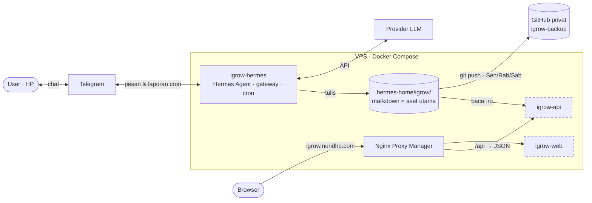
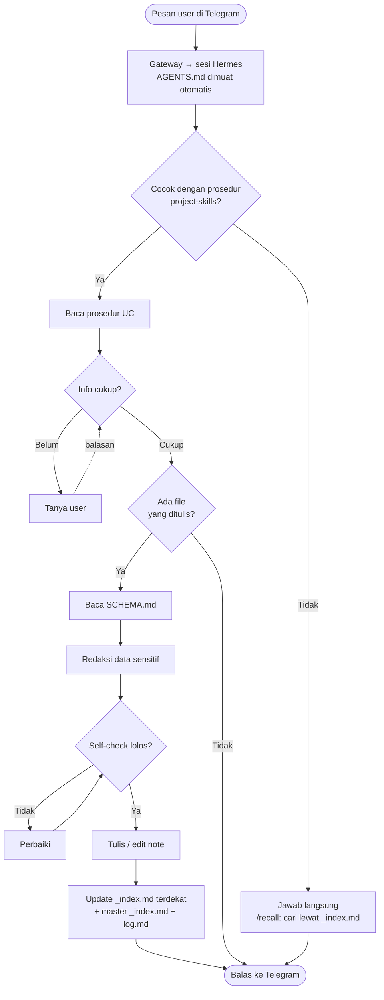
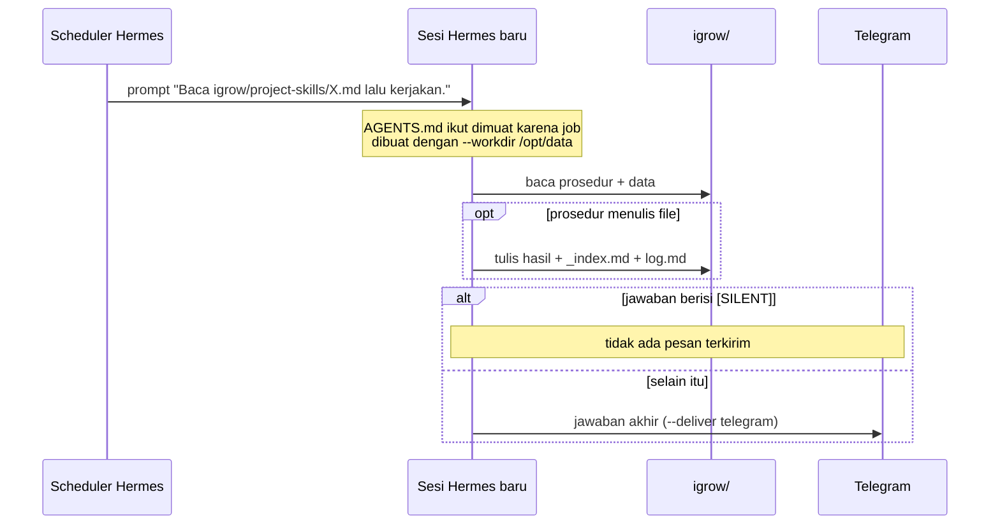
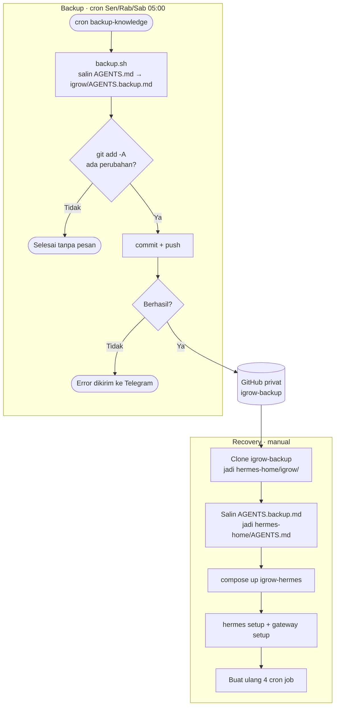

# 04 · Architecture

Dokumen ini menjelaskan bentuk sistem di tingkat produk. Langkah instalasi ada di [`docs/build.md`](../docs/build.md), konteks VPS ada di [`docs/vpslab.md`](../docs/vpslab.md), dan aturan format ada di [`SCHEMA.md`](../hermes-home/igrow/SCHEMA.md).

## 1. System Context



Semua service berjalan di satu VPS memakai Docker Compose, di belakang Nginx Proxy Manager (NPM). Kotak bergaris putus-putus belum dibangun (Phase 4). `igrow-hermes` sengaja tidak tersambung ke NPM (prinsip 3).

## 2. Komponen

| Komponen | Image / build | Peran | Terekspos ke publik | Phase | Status |
|---|---|---|---|---|---|
| Nginx Proxy Manager | `jc21/nginx-proxy-manager` | Reverse proxy, HTTPS (Let's Encrypt) | Ya (80/443) | 1 | ✅ |
| Portainer | `portainer/portainer-ce` | GUI manajemen Docker | Ya (`portainer.`) | 1 | ✅ |
| Glance | `glanceapp/glance` | Dashboard, status uptime, container, resource | Ya (`dash.`) | 1 | ✅ |
| Homepage | `nginx:alpine` | Portofolio statis di domain root | Ya (root) | 1 | ✅ |
| **igrow-hermes** | `nousresearch/hermes-agent:latest` | Agent + gateway Telegram + scheduler cron. **Satu-satunya yang menulis data.** | **Tidak** | 2 | ✅ Jalan, cron belum dibuat |
| Dozzle | — | Log viewer semua container | Internal | 3 | ⏳ |
| igrow-api | `build:` (kode custom) | Membaca markdown dan menyajikan JSON. Tidak memanggil LLM, tidak terhubung ke Telegram. | Lewat `/api` | 4b | ⏳ |
| igrow-web | `nginx:alpine` | Dashboard statis (read-only) | Ya (`igrow.`) | 4a | ⏳ Versi dummy ada di `web/` |
| CouchDB | `couchdb:3` | Backend Obsidian LiveSync | Tidak boleh publik tanpa proteksi | 5 | ⏳ Opsional |

## 3. Prinsip Arsitektur

1. **Satu penulis.** Hanya `igrow-hermes` yang menulis ke `igrow/`. Komponen lain membaca saja.
2. **Dashboard terisolasi dari bot.** `igrow-api` membaca folder yang sama dengan mount `:ro`, sehingga refresh dashboard tidak membebani bot dan tidak memakai token LLM.
3. **Bot tidak terekspos.** `igrow-hermes` tidak punya port publik dan tidak terdaftar di NPM. Satu-satunya jalur masuk adalah Telegram.
4. **Satu volume.** `hermes-home/` di host di-mount ke `/opt/data` (`HERMES_HOME`). Data iGROW dipisah di subfolder `igrow/`, supaya hanya folder itu yang di-backup dan dibagikan ke `igrow-api`.
5. **Pakai, jangan bangun.** Gateway, memory, tools, dan cron memakai image resmi Hermes. Yang custom hanya lapisan instruksi (markdown).

## 4. Lapisan Instruksi Agent

| Lapisan | File | Kapan dimuat | Isi |
|---|---|---|---|
| 1. Aturan inti | `hermes-home/AGENTS.md` | Otomatis di setiap sesi Telegram. Sesi cron hanya kalau job dibuat dengan `--workdir /opt/data` | Struktur folder, aturan penempatan, protokol tulis, larangan data sensitif, daftar prosedur |
| 2. Aturan format | `igrow/SCHEMA.md` + `igrow/taxonomy.md` | Sebelum setiap operasi tulis | Frontmatter, body template, aturan tag, link, threshold, format skill map. Daftar tag di `taxonomy.md` (D-28) |
| 3. Prosedur per UC | `igrow/project-skills/*.md` | Hanya saat relevan | Langkah detail, fallback, self-check, contoh eksekusi |

**Catatan penting:** `AGENTS.md` harus diletakkan di root `HERMES_HOME`, bukan di dalam `igrow/`. Di mode gateway, working directory Hermes selalu `/opt/data` (issue resmi `NousResearch/hermes-agent#5200`). Perilaku ini sudah teruji di Phase 2.

`project-skills/` adalah markdown biasa yang dirujuk dari `AGENTS.md`, **bukan** sistem Skill resmi Hermes (`SKILL.md`). Opsi upgrade ke sistem resmi dibahas di [OQ-06](06-risks-decisions.md#3-pertanyaan-terbuka).

## 5. Struktur Data

```text
hermes-home/                    → /opt/data (HERMES_HOME)
├── AGENTS.md                   aturan inti (dimuat setiap sesi)
├── .env, config.yaml, SOUL.md  milik Hermes (hasil `hermes setup`), tidak di-backup
├── (sessions/ memories/ skills/ cron/ ...)   state internal Hermes
└── igrow/                      ★ aset portable, di-backup ke Git
    ├── SCHEMA.md · _index.md · log.md · AGENTS.backup.md (salinan dari backup.sh)
    ├── raw/            inbox/ → articles/, assets/      (immutable)
    ├── wiki/
    │   ├── careers/career-N-{company}-{role}/
    │   │   ├── about.md · skills.md
    │   │   ├── knowledge/ (flat) + knowledge/incidents/
    │   │   └── lessons-learned/
    │   ├── self-development/   Project/ · Bootcamp/ · Dokumentasi/
    │   ├── roadmap/            skill-map.md · weak-topics.md
    │   └── profile/            skills.md · career-summary.md
    ├── output/                 career-review-YYYY-Qn.md
    └── project-skills/         prosedur UC1–UC5 + maintenance/
```

### Jenis File

| Jenis | Lokasi | Format |
|---|---|---|
| Note naratif (`knowledge`, `incident`, `lesson`, `learning`) | `wiki/careers/`, `wiki/self-development/` | Frontmatter lengkap + body template SCHEMA |
| Data file (`type: data`) | `wiki/roadmap/`, `wiki/profile/` | Frontmatter minimal + body berupa list atau key:value |
| Profil career | `about.md`, `careers/*/skills.md` | Plain `Key: value`, tanpa frontmatter |
| Laporan | `output/` | Markdown laporan |
| Katalog & jejak | `_index.md`, `log.md` | Tabel index; log append-only |

Detail field dan aturannya ada di [`SCHEMA.md`](../hermes-home/igrow/SCHEMA.md). Bagian ini sengaja tidak menyalinnya.

**Frontmatter adalah kontrak data untuk `igrow-api`.** Dashboard membaca frontmatter untuk index dan kategori, sedangkan body dibaca manusia. Mengubah nama atau arti field berarti mengubah API.

## 6. Alur Utama

### 6.1 Pesan Telegram → Knowledge



Kapan perlu bertanya, isi self-check, dan file apa yang ditulis diatur di masing-masing prosedur `project-skills/`. Diagram ini hanya menunjukkan bentuk alurnya.

`AGENTS.md` bukan pengambil keputusan. File itu hanya konteks yang selalu tersedia, dan keputusan tetap diambil oleh LLM.

### 6.2 Cron → Laporan



Setiap job berjalan di sesi baru tanpa riwayat chat. Tanpa `--workdir /opt/data`, sesi cron **tidak** memuat `AGENTS.md` (dokumentasi resmi Hermes, fitur cron). Jawaban yang berisi `[SILENT]` tidak dikirim. Saat ini tidak ada job yang memakainya; backup sengaja selalu lapor (D-27).

| Job | Jadwal (Asia/Kuala_Lumpur) | Prosedur |
|---|---|---|
| `daily-briefing` | `0 7 * * *`: setiap hari 07:00 | `daily-briefing.md` |
| `backup-knowledge` | `0 5 * * 1,3,6`: Senin, Rabu, Sabtu 05:00 | `maintenance/backup.md` |
| `lint-mingguan` | `0 8 * * 0`: Minggu 08:00 | `maintenance/lint.md` |
| `career-review` | `0 9 1 1,4,7,10 *`: tanggal 1 setiap kuartal, 09:00 | `career-review.md` |

Command pembuatan job ada di [`docs/build.md`](../docs/build.md) § Setup 4 Cron Job.

### 6.3 Backup & Recovery



Yang tidak bisa dipulihkan dari backup: memory dan skill internal Hermes, serta riwayat sesi. Ini sesuai prinsip bahwa sumber kebenaran hanya `igrow/`.

**Skenario migrasi yang harus tetap aman** (syaratnya backup berjalan rutin):

| Skenario | Yang dibawa |
|---|---|
| Hermes versi A → versi B | `igrow/` + `AGENTS.md` |
| Provider LLM A → provider B | Tidak ada yang perlu dipindah; cukup `hermes setup` ulang |
| VPS A → VPS B | Clone `igrow-backup` + deploy `hermes-home/` |
| Hermes → agent lain | `igrow/` tetap terbaca karena markdown biasa; `AGENTS.md` dan `project-skills/` perlu disesuaikan dengan format instruksi agent baru |

## 7. Deployment

- **Konfigurasi container:** `image: nousresearch/hermes-agent:latest`, `command: gateway run`, environment `HERMES_UID`/`HERMES_GID`/`TZ`, dan satu volume `./igrow-hermes/hermes-home:/opt/data`. Tidak ada `env_file:`; secret ditulis oleh `hermes setup`. `HERMES_HOME` tidak bisa dipindah lewat env var; path-nya tetap `/opt/data`.
- **Deploy runtime** dari `hermes-home/` di repo ini ke VPS, 2 langkah:
  1. `rsync -a --exclude '_index.md' --exclude 'log.md' --exclude 'taxonomy.md'`: aturan diperbarui, file milik agent (katalog, log, daftar tag) tidak tertimpa template repo.
  2. `rsync -a --ignore-existing`: file milik agent yang belum ada di VPS (setup pertama, atau file baru seperti `taxonomy.md`) tersalin sekali; yang sudah ada tidak disentuh.
- ⚠ Blok "Bikin 14 file inti" di `docs/build.md` sudah basi dibanding `hermes-home/`. Jangan dipakai untuk setup baru (pembersihannya ada di [05 · Roadmap](05-roadmap.md#3-prioritas-backlog)).

## 8. Domain

| Subdomain | Fungsi | Service |
|---|---|---|
| `nuridho.com` | Portofolio | `home` |
| `portainer.nuridho.com` | Manajemen Docker | `portainer` |
| `dash.nuridho.com` | Dashboard Glance | `glance` |
| `npm.nuridho.com` | Admin NPM | `nginx-proxy-manager` |
| `igrow.nuridho.com` | Dashboard iGROW (read-only) | `igrow-web` + `igrow-api` (Custom Location `/api`) |
